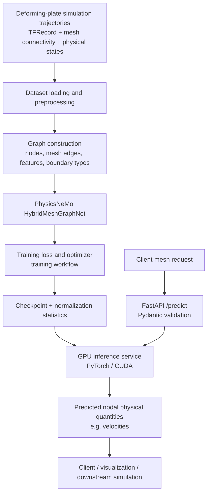
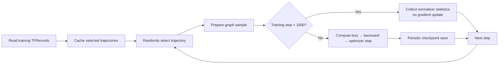
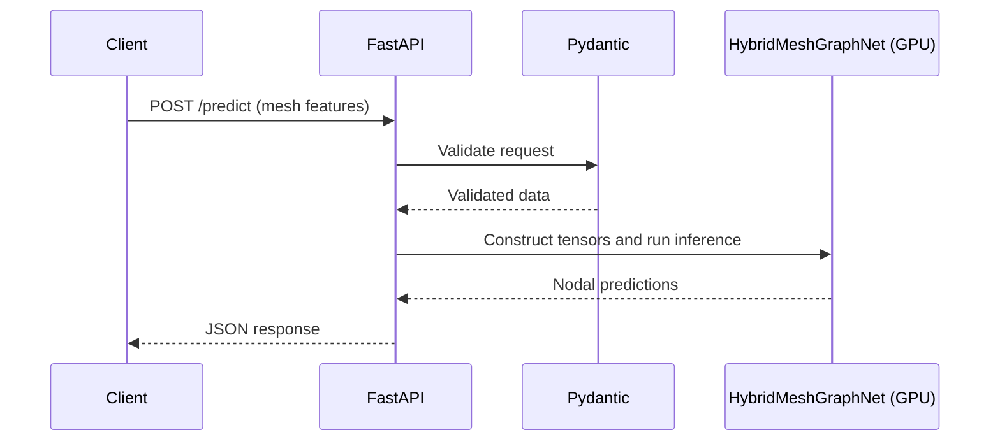
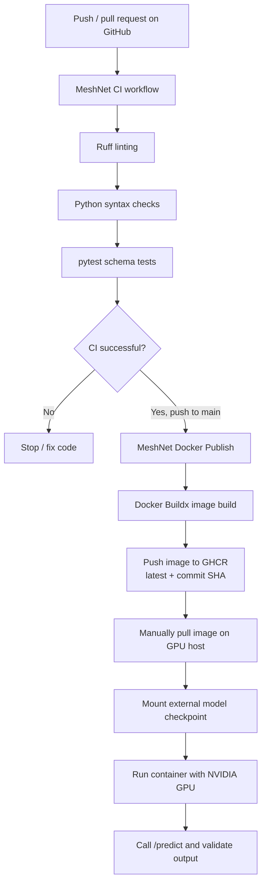
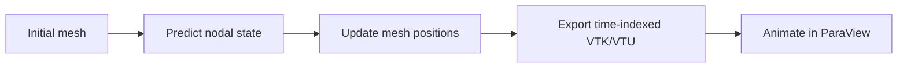

# MeshGraphNet: GPU-Accelerated Mesh-Based Physics Inference

**NVIDIA PhysicsNeMo · HybridMeshGraphNet · PyTorch · FastAPI · Docker · GitHub Actions**

This project implements a GPU-accelerated inference service for a **mesh-based graph neural network (GNN)** applied to a **deforming-plate simulation**. It connects scientific ML workflows—simulation trajectories, graph construction, training, and physical-state prediction—with practical ML engineering: an HTTP API, containerized CUDA inference, and automated CI and image publishing.

**Repository:** https://github.com/MohanElapolu/meshnet-graph-app

> **Scope:** The demonstrated application uses NVIDIA PhysicsNeMo's `HybridMeshGraphNet` architecture. This is separate from the independently developed FiGNNet fracture-mechanics research framework.

## 1. End-to-end system flow



**Two distinct paths:**

- **Training:** Simulation trajectories → graph samples → model loss → backpropagation → checkpoint.
- **Serving:** Input mesh → validated API request → checkpoint-loaded model → GPU predictions → JSON response.

## 2. How the model works

A finite-element-style mesh is represented as a graph:

| Physical simulation | Graph representation |
|---|---|
| Mesh vertices | Graph nodes |
| Mesh connectivity | Graph edges |
| Geometry and physical state | Node/edge features |
| Boundary conditions / node categories | Input attributes |
| Predicted physical state | Per-node model output |

`HybridMeshGraphNet` uses graph-based message passing to learn interactions between connected parts of the discretized physical system. The deployed deforming-plate application returns predicted nodal quantities such as velocities; interpretation and time integration depend on the dataset and rollout implementation.

### Training loop at a glance



The first 1,000 iterations in the training code are reserved for normalizer-statistics warm-up. Later iterations update model weights. The learning rate follows a decaying schedule, and checkpoints are saved periodically. The exact temporal sampling strategy is defined by `prepare_training_sample()`.

## 3. Inference request flow



Available application endpoints:

- `GET /health` — service health endpoint.
- `POST /predict` — graph/mesh-based inference.

The precise request schema is defined in **`app/schemas.py`**. Consult that file when constructing a payload; do not assume the illustrative graph features above are the complete API contract.

## 4. CI/CD and container delivery



The CI workflow tests code and request validation **without needing a GPU runner**. GPU inference is verified separately on the local NVIDIA GPU. Publishing an image to GHCR is automated; rollout to the GPU host is **manual**, not an automated production deployment.

## 5. Run the published GPU inference service

### Prerequisites

- Docker Desktop / Docker Engine configured for NVIDIA GPU access.
- A compatible NVIDIA GPU, driver, and container runtime.
- The trained `.mdlus` model checkpoint available locally in `checkpoints/`.

Pull the published container image:

```powershell
docker pull ghcr.io/mohanelapolu/meshnet-graph-app:latest
```

Run it on a GPU with the checkpoint directory mounted read-only:

```powershell
docker run --rm --gpus all `
  -p 8000:8000 `
  -v "${PWD}/checkpoints:/app/checkpoints:ro" `
  --name meshnet-api `
  ghcr.io/mohanelapolu/meshnet-graph-app:latest
```

In a second terminal, check service health:

```powershell
curl.exe http://localhost:8000/health
```

Submit the repository's representative inference request:

```powershell
uv run python tests/test_api.py
```

The `tests/test_api.py` script is an integration/example client, not necessarily a pytest-discovered unit test. It expects the sample data and service setup used by the project.

## 6. Testing strategy

| Level | What is checked | Where |
|---|---|---|
| Static checks | Ruff and Python syntax | GitHub Actions CI |
| Lightweight unit tests | Actual Pydantic request schema, including default and invalid radius behavior | GitHub Actions CI |
| API integration | FastAPI request/response behavior | Local development |
| GPU integration | Checkpoint loading and real CUDA inference | Local GPU |
| Published artifact verification | GHCR pull → container start → real prediction | Local GPU |

The published container was pulled and tested on an **NVIDIA RTX 5060 (8 GB)**; it returned nonzero node-velocity predictions from a representative mesh input.

## 7. Project organization

The key paths discussed and used in the implementation include:

```text
meshnet-graph-app/
├── app/
│   ├── schemas.py            # Pydantic inference request contract
│   └── inference.py          # Inference-related implementation
├── tests/
│   ├── test_api.py           # Local API integration/example client
│   └── test_dataset.py       # Dataset inspection/example script
├── checkpoints/             # Local model artifacts (not embedded in CI image)
├── stats/                   # Normalization statistics
├── .github/
│   └── workflows/
│       ├── ci.yml            # Lint, syntax and pytest
│       └── docker.yml        # Docker image publishing
├── Dockerfile
├── pyproject.toml
└── uv.lock
```

*This is a focused map of known components, not an exhaustive listing of repository files.*

## 8. Engineering challenges and solutions

| Challenge | Approach |
|---|---|
| Heavy CUDA dependencies in CI | Separate API schemas from GPU-dependent imports; run lightweight tests on Ubuntu runners |
| CUDA / PyG dependency compatibility | Install compatible PyTorch and `torch-scatter` wheels in the container |
| Model artifact size and deployment coupling | Keep checkpoint outside the container and mount it read-only |
| Prevent unvalidated image publication | Trigger Docker publishing after successful CI |
| Prove the image works beyond build success | Pull from GHCR and run real GPU inference through the API |

## 9. Visualization and future work

The intended visualization path is:



**Important:** A single `/predict` request is not a time-series rollout. Animating an evolving plate requires consecutive states and an appropriate update/integration procedure. The repository's ParaView export workflow has not yet been established as part of the validated deployment path.

Potential next improvements:

1. Numerical regression tests against reference simulation trajectories.
2. Benchmarking p50/p95/p99 latency, throughput, and GPU memory across mesh sizes.
3. Versioned checkpoint metadata and model-artifact management.
4. Monitoring, logging, and GPU resource observability.
5. Time-series rollout export for ParaView and automated GPU-host deployment.

## 10. Technology stack

| Area | Tools |
|---|---|
| Scientific ML | NVIDIA PhysicsNeMo, HybridMeshGraphNet |
| Deep learning | PyTorch, PyTorch Geometric |
| Serving | FastAPI, Pydantic, Uvicorn |
| GPU execution | CUDA, NVIDIA GPU |
| Packaging | Docker, uv |
| Quality checks | Ruff, pytest |
| CI/CD | GitHub Actions, Docker Buildx, GHCR |
| Visualization (planned integration) | ParaView, VTK/VTU |

---

**Project outcome:** A functioning, containerized, GPU-backed MeshGraphNet inference application with automated code validation and container publishing, validated end-to-end from GitHub to local GPU predictions.